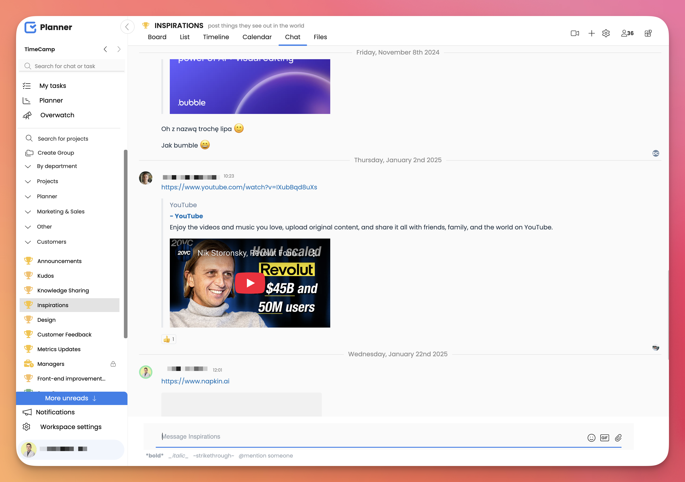
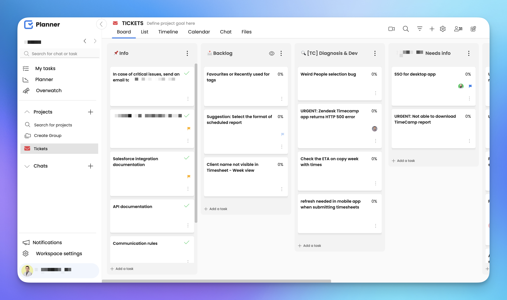

# TimeCamp Planner



All-in-one project management and team chat for product teams that want speed without the bloat.  
Plan work, track progress, and keep conversations close to the tasks.

## Why TimeCamp Planner 🚀

- **Projects, tasks, and realtime chat** in one workspace 🧩
- **Backend API + modern web frontend** out of the box 🧱
- **Docker-first setup** to run locally in minutes 🐳
- **Open architecture** for customization and integrations 🔌

## What you get ✨

- Task planning with lists and workflows ✅
- Team chat tied to work context 💬
- Realtime collaboration ⚡️
- API-first backend for integrations 🔗
- Self-hosted, full-stack codebase 🏠

## Project structure 🧭

- `backend/` - Node.js/TypeScript backend API server
- `frontend/` - React/TypeScript frontend application

## Quick Start with Docker 🐳

The easiest way to run the entire project is using Docker Compose.

### Prerequisites ✅

- Docker Desktop (or Docker Engine + Docker Compose)
- At least 4GB of available RAM
- Ports 3001, 3002, 3003, 5433, 6379, 5672, 15672, 8080, 9000, 9001, 1025 and 8025 available

### Running the Project ▶️

1. **Start all services (can take 5+ min to compile):**
   ```bash
   cp .env.sample .env
   docker compose up
   ```

2. **Start in detached mode (background):**
   ```bash
   docker compose up -d
   ```

3. **View logs:**
   ```bash
   docker compose logs -f
   ```

4. **Stop all services:**
   ```bash
   docker compose down
   ```

### Accessing the Application 🌐

Once all services are running:

- **Frontend:** http://localhost:3002 (mapped from container port 3000)
- **Backend API:** http://localhost:3001
- **RabbitMQ Management:** http://localhost:15672
- **MinIO Console (files):** http://localhost:9001
- **Mailpit (e-mails sent by the app):** http://localhost:8025

**Note:** Ports 3000 and 5432 are mapped to 3002 and 5433 respectively to avoid conflicts with local services.

### Services 🧰

The Docker Compose setup includes:

- **PostgreSQL** (port 5432) - Database
- **Redis** (port 6379) - Caching
- **RabbitMQ** (ports 5672, 15672) - Message queue
- **Backend** (port 3001) - API server
- **Frontend** (port 3000) - Web application
- **Ntfy** (port 8080) - Push notifications
- **MinIO** (ports 9000, 9001) - S3-compatible file storage (community `pgsty/minio` build, because MinIO no longer publishes Docker images)
- **Mailpit** (ports 1025, 8025) - Local SMTP server that catches e-mails

### Configuration ⚙️

- **Frontend:** without a local config the frontend uses `frontend/config.example.js` (local Docker addresses). To change it, copy that file to `frontend/app/common/config/web.config.js` and edit the copy. `amazonResizeUrl` is the base URL of an image resize service; leave it empty to show original images.
- **File storage:** web browsers upload files directly to MinIO, so `FILE_STORAGE_PUBLIC_ENDPOINT` (default `localhost:9000`) must be an address that browsers can open. The backend itself uses `minio:9000` inside Docker.
- **Password link:** without e-mail, an administrator can make a link to set a password:
  ```bash
  docker compose exec backend node dist/console.js users:reset-password-link person@example.com
  ```

### Database Setup 🗄️

Migrations run automatically on first startup. If you need to reset the database:

```bash
docker compose down -v
docker compose up --build
```

## Screenshots




## Roadmap 🛣️

- One-command local setup
- Simplified hosting with custom domains
- Repository cleanup and docs polish